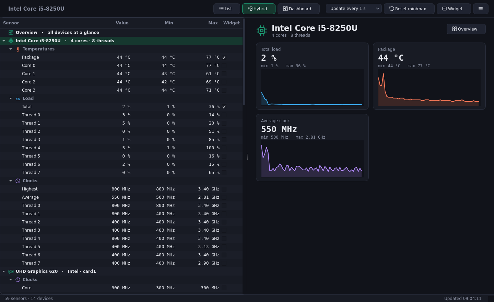
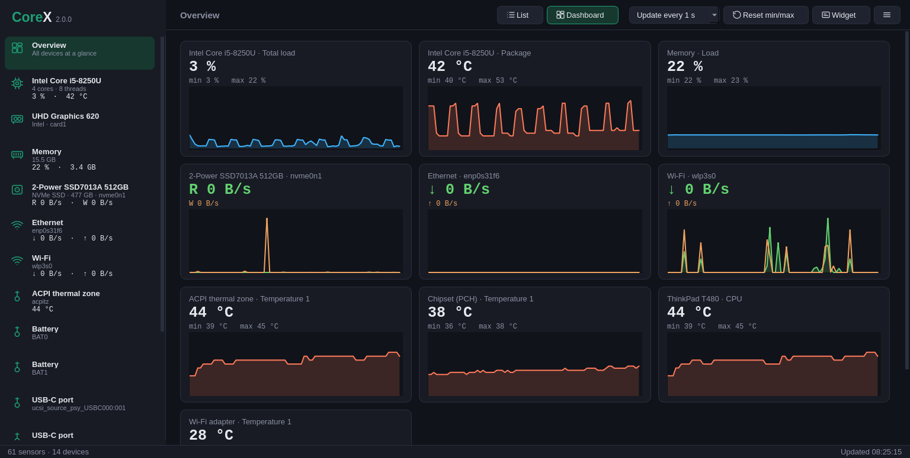
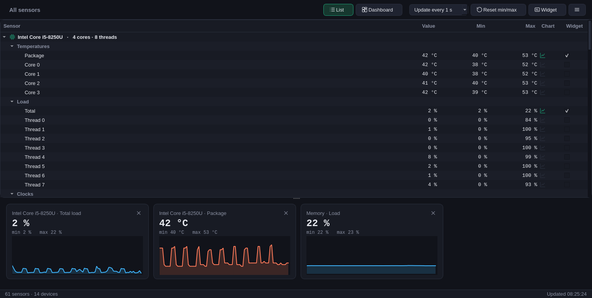
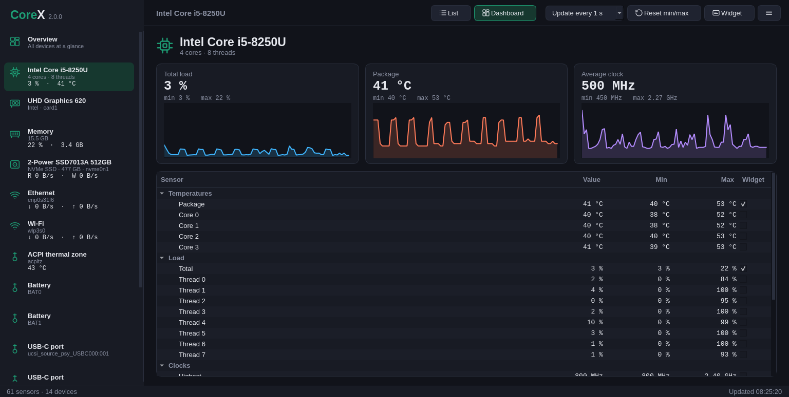
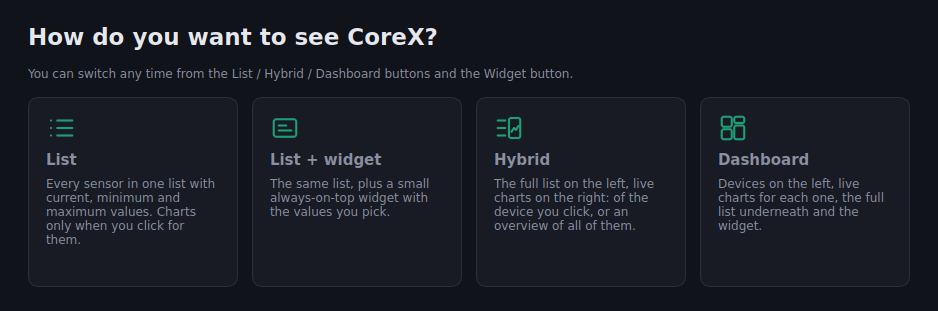

# CoreX — Hardware Monitor for Linux

> "Your machine's core, exposed."

A hardware monitor for Linux: every sensor in one list with current, minimum
and maximum values, live charts when you want them, and a small always-on-top
widget with the values you pick.

## Features
- **Four ways to see it** — chosen at first start, switched any time:
  - **List**: every sensor with value, min and max; charts on demand
  - **List + widget**: the same list plus the floating widget
  - **Hybrid**: the full list on the left, live charts on the right — of the device you click,
    or the overview of all of them
  - **Dashboard**: devices on the left, live charts per device, full list underneath
- **Your own overview** — choose its charts and their order, or right-click any sensor › Add to the overview
- **Floating widget** — always on top; tick any sensor to add it, Ctrl + drag to move it
- **Widget editor** — place every value freely (edges stick to the other values), align several at
  once or arrange them in 1-3 columns, pick icons and text sizes, set the size,
  the background opacity and a background picture from the gallery or your own file
- **History** — every sensor recorded per minute (average and highest), charts from the last
  hour to 30 days, CSV export; kept 7 days to 1 year
- **Alerts** — above or below any value, with a desktop notification
- **System report** — your hardware and its readings as text, ready to paste in a forum post
- **Dark, light or system theme**
- **Real names** — CPU, GPU, disks, network, batteries and board sensors named
  for what they are, not `temp1`; rename any of them from the list
- **Your view is remembered** — hidden sensors, folded groups, charts and column widths
- **Start with the system** — one tick in the ☰ menu
- Intel, AMD and NVIDIA processors and graphics cards, NVMe / SATA drives, laptops and desktops
- Reads the kernel directly (`/sys`, `/proc`) — no extra tools to configure

## Screenshots

### Hybrid view

### Dashboard

### List with charts on demand

### Device page

### First start

## Installation

### Flathub
  flatpak install flathub io.github.edewin.corex

### From source
Requirements: Linux with X11 or XWayland, Python 3.10+.

  sudo apt install libxcb-cursor0 python3-pip      # Ubuntu / Zorin OS / Linux Mint
  git clone https://github.com/Edewin/corex.git
  cd corex
  pip3 install -r requirements.txt --break-system-packages
  python3 -m corex

On desktop boards some temperature and fan chips need their kernel driver
loaded first; `sudo sensors-detect --auto` (package `lm-sensors`) does that once.

## Author
Eduard Soltuzu

## License
MIT
